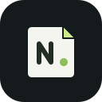
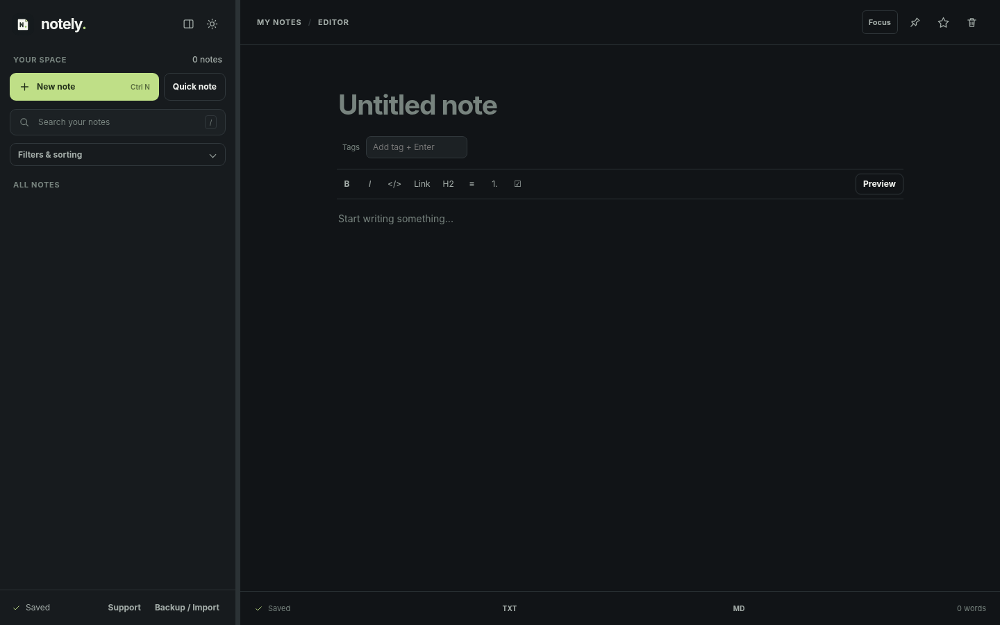
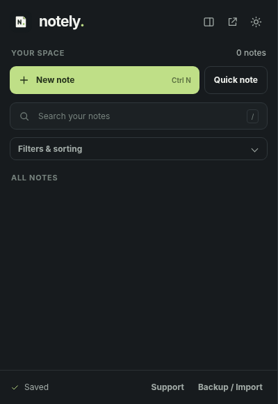

<div align="center">
  

  # Notely

  **Your thoughts. In your space.**

  A focused, local-first notes extension for Google Chrome. Capture ideas quickly, organize your notes, and write in Markdown—without an account or cloud dependency.

  
  
  
  
</div>

## Preview

| Notes workspace | Toolbar popup |
| --- | --- |
|  |  |

*These are historical static Chromium screenshots of the actual UI, not proof of the installed extension at v2.1.3.*

## What it does

- **Fast notes:** Create, search, organize, pin and edit multiple notes.
- **Markdown writing:** Lightweight formatting and distraction-reduced workspace.
- **Three surfaces:** Toolbar popup, Chrome side panel, and full-tab workspace.
- **Quick capture:** Save selected page text using an explicit context-menu action.
- **Local-first:** Notes and preferences are stored using Chrome local storage; no account or automatic cloud sync.
- **Portable backups:** User-controlled JSON export, import, and recovery safeguards.
- **Optional support:** Static USDC-on-Solana QR/address; no wallet integration or payment API. Verify the recipient and network independently before sending funds.

## Install from source

> This project is a **local release candidate**. It is not published in the Chrome Web Store, and its native MV3 integration has not been fully verified.

1. Download or clone this repository.
2. Open `chrome://extensions` in Google Chrome.
3. Turn on **Developer mode**.
4. Choose **Load unpacked** and select the repository folder containing `manifest.json`.
5. Open Notely from the extensions toolbar; optionally use Chrome's side-panel controls.

The extension is **not** installed by running `npm install` or opening `popup.html` in an ordinary tab. See [Installation & troubleshooting](docs/INSTALLATION.md).

## Development

Requirements: Node.js with built-in `node:test` support. No npm runtime or build dependencies are required.

```bash
npm run check
npm test
npm run audit:release
```

`npm test` uses simulated extension/storage boundaries; it does not certify installed-Chrome behavior. See [Contributing](CONTRIBUTING.md) and [Architecture](docs/ARCHITECTURE.md).

## Privacy & permissions

| Permission | Why it is needed |
| --- | --- |
| `storage` | Save local notes, settings and recovery data |
| `contextMenus` | Add user-invoked “Save selection to Notely” |
| `sidePanel` | Display the native Chrome side panel |

No host permissions or automatic cloud sync are declared. Notes can be lost if the extension/profile data is cleared—**export regular backups**. See [Privacy & data handling](docs/PRIVACY.md) for the source-based disclosure and [security policy](SECURITY.md).

## Status & roadmap

**v2.1.3:** Recovery save coordination blocks competing discard/import actions, preserving drafts on failed writes. The last locally recorded verification was 145/145 Node tests; native multi-window Chrome integration remains unverified. Read the [roadmap](ROADMAP.md) and [changelog](CHANGELOG.md).

## License

No open-source license has been granted for this source. All rights remain with their respective copyright holder(s) unless a license is added by the owner. See [CONTRIBUTING.md](CONTRIBUTING.md) before proposing changes.
